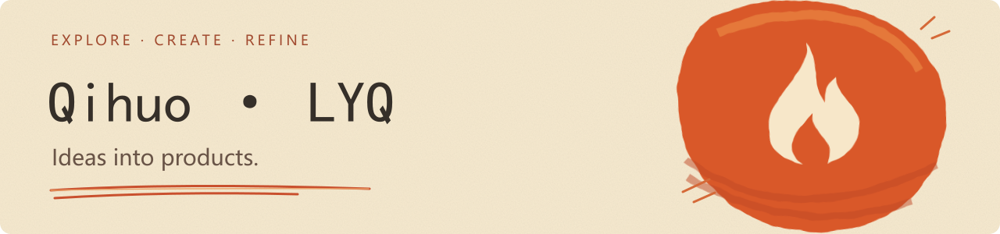

<a href="https://github.com/lyq-05">简体中文</a> · <strong>English</strong>

I build useful products with AI agents, starting from everyday ideas. Learning by making, refining through use.

### Things I'm building

| Project | The idea behind it |
| :--- | :--- |
| **[Youyu Ledger](https://github.com/lyq-05/youyu-ledger)** | A local Android ledger with a hand-drawn feel, built for everyday tracking. |
| **[Personal Workbench](https://github.com/lyq-05/personal-workbench)** | A personal space for plans, focus, knowledge, and journaling. |
| **[Nianhen](https://github.com/lyq-05/nianhen)** | Customizable photo watermarks for everyday moments and work records. |

### Learning by making

Working with agents · Product experience · From prototype to release

I'm also working on [Kemai-tu](https://github.com/lyq-05/kemai-tu) and [CareerFlow](https://github.com/lyq-05/careerflow), and sharing my release workflow as a [GitHub Release Skill](https://github.com/lyq-05/agent-skill-github-releases).

Some repositories contain product showcases and downloads; their source code remains private.

---

Give an idea a form people can use. <a href="https://github.com/lyq-05?tab=repositories">Explore all projects →</a>
