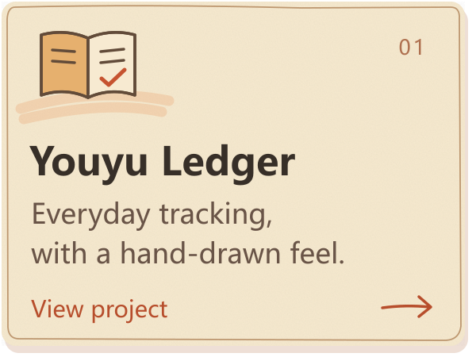
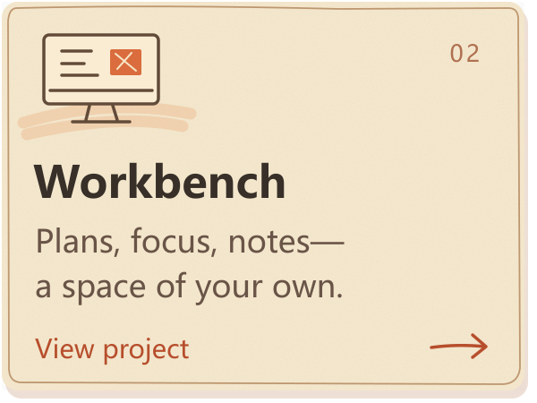
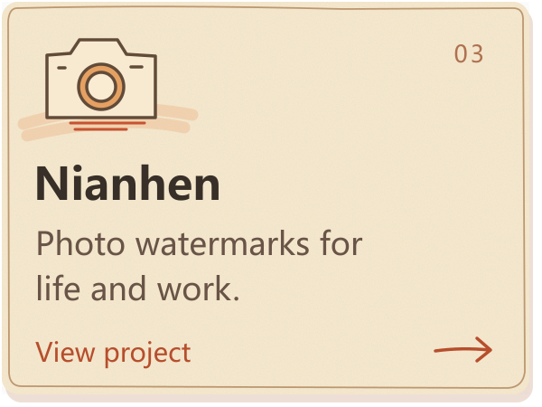

<a href="https://github.com/lyq-05">简体中文</a> · <strong>English</strong>

I build useful products with AI agents, starting from everyday ideas. Learning by making, refining through use.

### Things I'm building

  
  
  

### Learning by making

Working with agents · Product experience · From prototype to release

More to explore: [Kemai-tu](https://github.com/lyq-05/kemai-tu) · [CareerFlow](https://github.com/lyq-05/careerflow) · [GitHub Release Skill](https://github.com/lyq-05/agent-skill-github-releases)

---

Give ideas a form people can use, and let everyday use shape them into something better.  <a href="https://github.com/lyq-05?tab=repositories">Explore all projects →</a>

