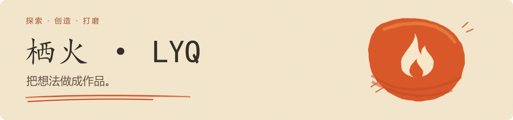
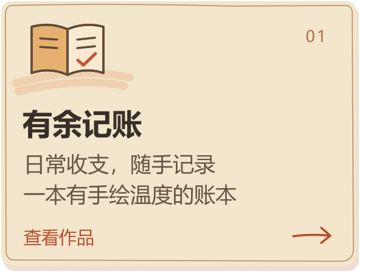
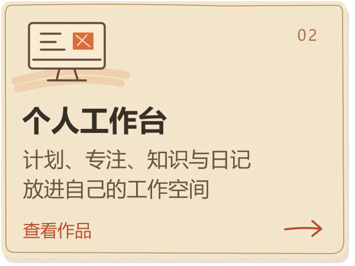
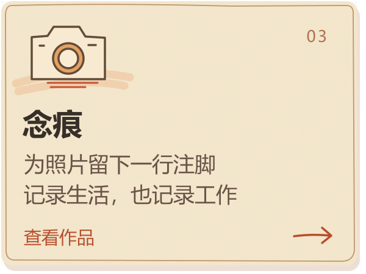

<strong>简体中文</strong> · <a href="https://github.com/lyq-05/lyq-05/blob/main/README.en.md">English</a>

借助 Agent，把日常里的想法做成能用的产品。边做边学，在使用中打磨。

### 正在打磨

  
  
  

### 边做边学

Agent 协作 · 产品体验 · 从原型到发布

更多探索：[客脉图](https://github.com/lyq-05/kemai-tu) · [CareerFlow](https://github.com/lyq-05/careerflow) · [GitHub 发布 Skill](https://github.com/lyq-05/agent-skill-github-releases)

---

让想法有一个可以被使用的形状。 <a href="https://github.com/lyq-05?tab=repositories">浏览全部作品 →</a>

